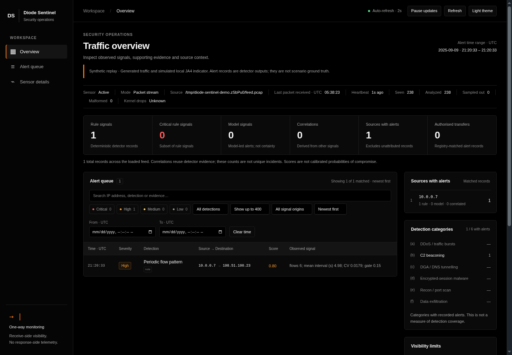
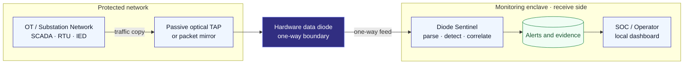
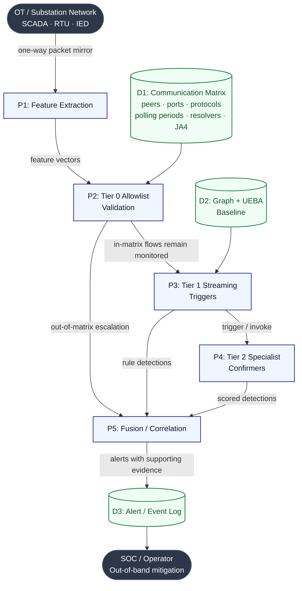
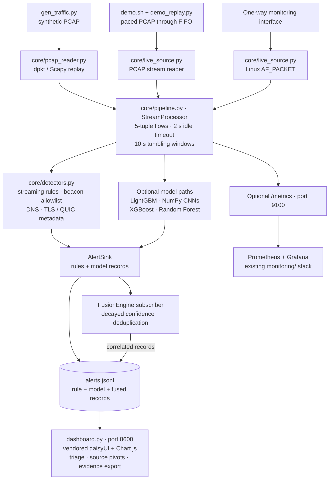
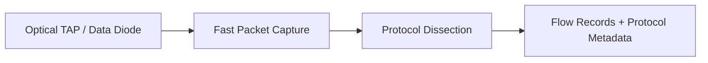
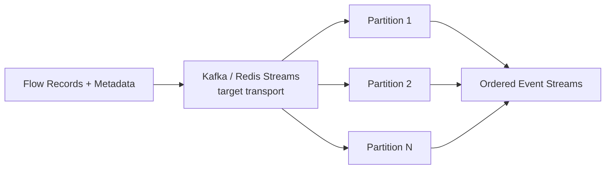
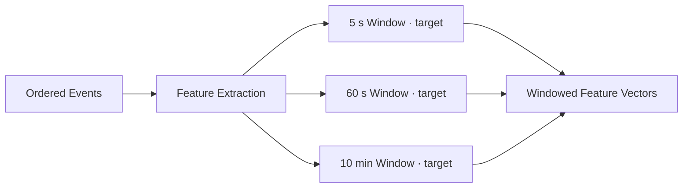
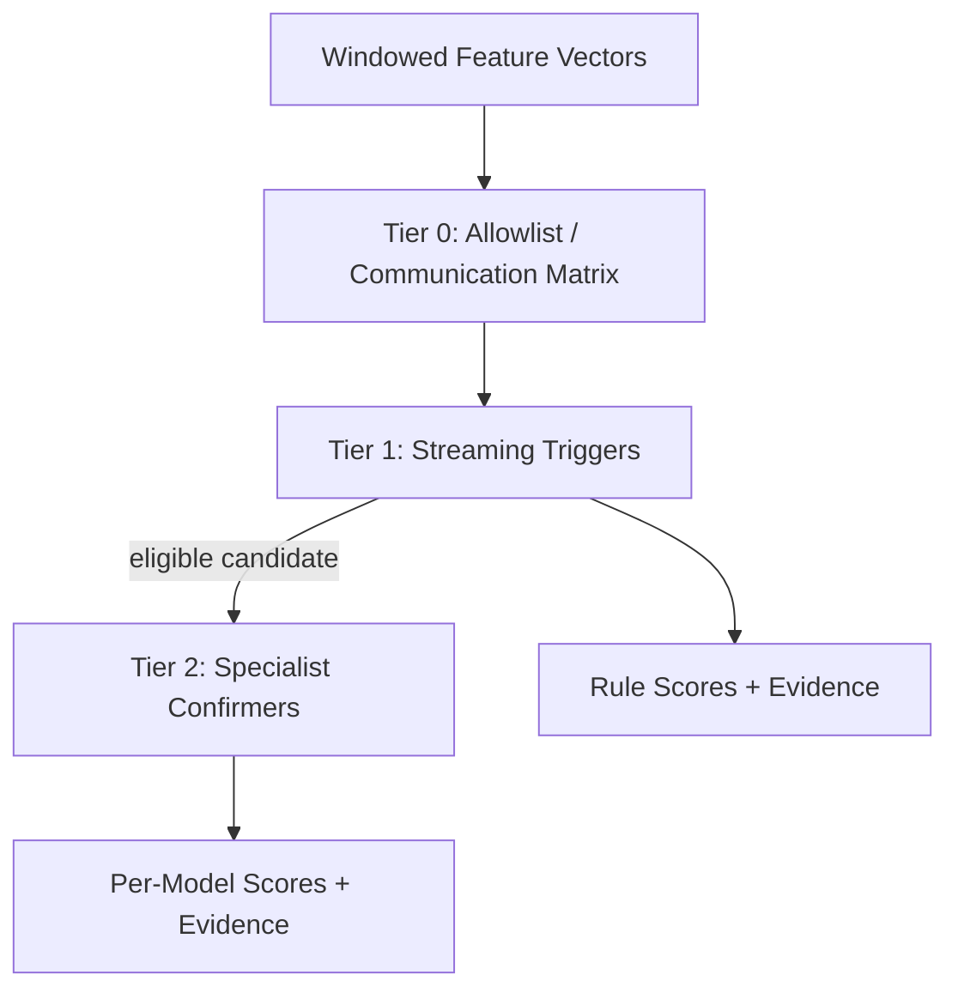
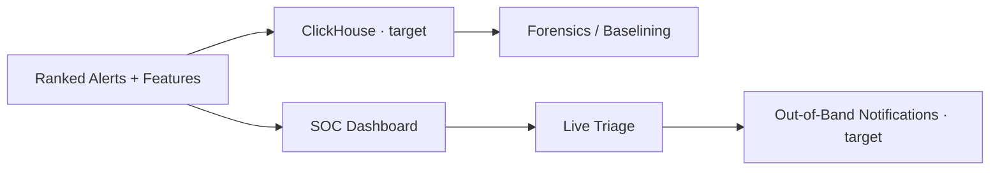

# Diode Sentinel

## An AI-Powered Passive Threat Detection Pipeline for Unidirectional, Air-Gapped, and Data-Diode-Isolated Network Traffic

**Diode Sentinel** is a streaming machine learning pipeline designed to detect, classify, and score cyber threats under strictly unidirectional network constraints. It is designed for the receive side of a hardware data diode or a passive optical TAP, giving security teams visibility into observed traffic without probing the protected network or creating a response path through the diode.

**Project context:** SIH 2026 · PS-26145 · AI-Based Detection of Cyber Threats in Unidirectional IP Traffic.

> **Implementation status:** This repository contains a runnable Python prototype with packet replay, Linux live-capture support, streaming rules, optional CPU-based models, JSONL alerts, and a local SOC dashboard. The six-stage architecture below describes the target deployment. Technologies and performance targets that are not implemented are identified explicitly; installing Kafka, Zeek, Flink, ONNX, or ClickHouse is not required to run this repository.

[Quick start](#quick-start) · [Architecture](#architecture) · [Detection pipeline](#detection-pipeline) · [Threat methodology](#threat-detections-and-methodology) · [Execution guide](#execution-guide) · [Documentation](#documentation)

## The Problem: The Unidirectional Blind Spot

Critical infrastructure uses hardware data diodes to restrict traffic from entering a protected facility. If a secure network is compromised internally through infected removable media, an insider, or a compromised supply chain, malware may still attempt to contact command-and-control infrastructure, spread, or exfiltrate data through permitted outbound paths.

Diode Sentinel requires **no two-way communication with the monitored network**. It analyzes a one-way packet copy on the monitoring side. The target architecture also accommodates asymmetric NetFlow/IPFIX/sFlow telemetry; the current prototype reads packets from PCAP files, PCAP streams, or Linux AF_PACKET sockets and constructs its own flow statistics. Native flow-export protocol ingestion is future work.

The sensor sends no probes and requires no completed handshakes. It uses observable client metadata rather than decrypted application content. For supported QUIC v1 Initial packets, it removes Initial protection using public protocol inputs to recover ClientHello metadata; application payloads remain opaque.

## Quick start

The easiest way to explore the project is the **synthetic live dashboard demo**. Use Linux, Python **3.14 or newer**, [uv](https://docs.astral.sh/uv/), and Bash **5.1 or newer** for `demo.sh`. Dependency installation needs internet access or a prepared offline package cache. No GPU, Node.js, Docker, capture privileges, or model training is needed for this demo.

From a new checkout:

```bash
git clone https://github.com/make-ki/diode-sentinel.git
cd diode-sentinel/oneway-ids
uv sync --locked
./demo.sh
```

If the repository is already open, start with `cd oneway-ids` from its root, then run the last two commands. Open **[http://localhost:8600](http://localhost:8600)** once the script prints the dashboard address.

The script generates a fresh 600-second synthetic capture in a temporary directory, starts the dashboard, and replays the capture at 10× speed through the normal PCAP-stream path. It enables the rules and shipped DGA character CNN. Alerts appear during replay; the completed dashboard stays open until **Ctrl+C**, which stops the child processes and removes the temporary demo files. Displayed counts describe synthetic demonstration data.

```bash
./demo.sh --speed=25             # faster replay
./demo.sh --port=8601            # use another dashboard port
```

On **NixOS**, enter the existing development shell before syncing dependencies:

```bash
cd oneway-ids                   # from the repository root
nix develop
uv sync --locked
./demo.sh
```

Without flakes, use `source .env-ml` before Python commands on NixOS. Other Linux distributions do not need this loader shim. The script also sources it automatically when present. More setup and troubleshooting details are in the [simulation guide](oneway-ids/docs/run-simulation.md).



*Existing dashboard capture; this image is a synthetic demonstration, not a performance or accuracy result.*

## Architecture

### Deployment boundary

The arrows below show the direction of monitored data. Analyst access and any optional monitoring services remain on the receiving side. A passive TAP copies traffic; the hardware diode supplies the enforced one-way boundary where deployed.



Operators perform mitigation through separately authorized procedures on the secure side. Diode Sentinel provides alert-only analysis; it does not send response actions through the diode.

### Target detection architecture

This is the proposed communication-matrix and tiered-detection design. The communication matrix and graph/UEBA baseline represent the full target; the prototype has a curated beacon allowlist and bounded behavioral baselines rather than a complete graph service. Here, “allowlist validation” means policy checking, not proof that a flow is harmless.



### Implemented architecture

This is the code path used by the quick start. All ingestion modes share `core/pipeline.py`; there is no broker or separate feature service in the current runtime. Rule alerts and model alerts both enter the alert sink, whose subscribers perform correlation.



The prototype parses IPv4 TCP/UDP traffic, DNS queries, TLS ClientHello metadata, and supported QUIC v1 Initials. A physical AF_PACKET capture still needs validation on an explicitly selected test interface; the replay and FIFO paths have existing automated coverage.

## Detection pipeline

The six stages describe the intended appliance architecture. Each stage also identifies the equivalent code shipped here.

### Stage 1: Fast Packet Capture & Dissection

**Target technologies:** DPDK, AF_PACKET ring buffers or PF_RING for capture; Zeek or Suricata in parser-only mode for dissection.

The target is to ingest **1–10 Gbps unidirectional optical feeds**, retain only necessary data, parse Ethernet, IPv4/IPv6, TCP/UDP, ICMP, DNS, TLS, and QUIC, and emit IPFIX/NetFlow records plus protocol metadata. This is a capacity and integration target, not a measured throughput claim for this repository.

**Implemented:** `core/pcap_reader.py` uses dpkt or Scapy; `core/live_source.py` provides AF_PACKET and PCAP-stream sources. `core/tls_meta.py` and `core/quic_meta.py` extract client handshake metadata. No Zeek/Suricata runtime, DPDK/PF_RING integration, native flow-export ingestion/export, or IPv6/ICMP detector path is shipped.



### Stage 2: Stream Transport & Buffering

**Target technologies:** Apache Kafka or Redis Streams, partitioned by flow key with back-pressure handling inside the monitoring enclave.

This layer decouples packet capture from analytics, buffers bursts, preserves ordering per flow, and absorbs temporary downstream slowdowns. A canonical flow key should include the endpoint ports as well as addresses and protocol. Buffering can reduce downstream losses, but it cannot recover packets already lost at the diode or capture interface; there is no retransmission path across the diode.

**Implemented:** Direct in-process streaming and an optional FIFO. No Kafka/Redis service or durable event bus is required. The AF_PACKET path reports capture drops and supports deterministic sampling through `--sample N`; PCAP replay cannot measure kernel capture drops.



### Stage 3: Feature Extraction & Windowing

**Target technologies:** Polars or Apache Flink, with 5-second, 60-second, and 10-minute sliding windows and a shared feature bus.

The design includes source-IP Shannon entropy, packet-rate changes, inter-arrival-time vectors, FFT spectral power, HLL fan-out estimates, JA3/JA4 client fingerprints, packet-length/time sequences (SPLT), observed traffic volume, and outbound volume relative to a device baseline. An outbound/inbound byte ratio cannot be computed from a strictly one-way feed.

**Implemented:** `FlowAssembler` and `WindowAggregator` compute statistics in Python using **10-second tumbling windows** and a **2-second idle timeout**. Packet sequences are bounded; beaconing uses inter-flow timing variation. Exact-set fan-out is used instead of HLL. Optional `--rolling-scan` adds a 60-second scan horizon; `--source-context` adds source-specific destination history. The prototype has no Polars/Flink feature bus or FFT detector.



### Stage 4: Multi-Model Inference

**Target technologies:** ONNX Runtime, XGBoost/LightGBM, Random Forest, and specialist sequence/anomaly models. PyTorch-based 1D-CNNs, autoencoders, and portable ONNX exports are design options, not installed components.

The proposed tiering uses inexpensive policy checks and streaming triggers before specialist confirmation:

| Tier | Purpose | Target examples | Current implementation |
|---|---|---|---|
| **0 · Allowlist** | Apply operator-reviewed communication policy | Peer/port/protocol matrix | Curated destination/port beacon suppression; not a universal bypass |
| **1 · Triggers** | Identify suspicious observable behavior | Z-score, sketches, change-point detection, graph statistics | Rate/cardinality thresholds, timing CV, DNS lexical rules, fingerprint matches and novelty, transfer baselines |
| **2 · Confirmers** | Add model evidence where eligible | Gradient boosting, forests, sequence CNNs, anomaly models | Optional LightGBM, NumPy DGA CNN, and category-specific XGBoost/Random Forest/packet CNN bundle |

The shipped CNNs run directly in NumPy; the runtime uses no PyTorch or ONNX. Model scheduling follows flow-close, DNS-query, and window-flush events rather than a universal trigger-only gate. Isolation Forest scores are supporting evidence on corroborated supervised alerts, not standalone anomaly verdicts.



### Stage 5: Alert Synthesis, Correlation & MITRE Mapping

**Target technologies:** Rule-based and weighted-score fusion, with MITRE ATT&CK technique tagging.

The target correlates evidence such as DNS entropy, JA4 novelty, and outbound-volume changes, deduplicates related alerts, assigns severity/confidence, and emits standardized JSONL records with technique context. Correlation strengthens the evidence for triage; it does not by itself prove exfiltration or compromise.

**Implemented:** `FusionEngine` uses noisy-OR over exponentially decayed confidence scores and fire-on-escalation deduplication. `AlertSink` emits timestamps, source/destination, flow identifiers, threat class, confidence, severity, and evidence. **MITRE technique IDs are not currently emitted.** Confidence scores are not calibrated probabilities.


### Stage 6: Storage, Visualization & SOC Delivery

**Target technologies:** ClickHouse for columnar history; Grafana or React for analyst views.

The intended retention layer supports forensics, historical analysis, behavioral baselining, incident investigation, and live triage. Alert delivery and operator response remain on approved out-of-band paths.

**Implemented:** Local JSONL alert storage, JSON statistics/health sidecars, restart-safe fingerprint state, and a Python standard-library dashboard with locally vendored daisyUI/Chart.js assets. It supports filtering, source pivots, and selected-alert evidence export. Optional Prometheus/Grafana services monitor the sensor. ClickHouse, a React SOC app, and automated notification delivery are future integrations. The separate TypeScript/Remotion project makes presentation videos; it is not a sensor dependency.



### Pipeline summary

| Stage | Component | Target technology | Input → Output | Shipped equivalent |
|---|---|---|---|---|
| **1** | Capture & dissection | DPDK/PF_RING, Zeek/Suricata | Optical traffic → flow records + metadata | dpkt/Scapy, AF_PACKET, PCAP stream |
| **2** | Stream transport | Kafka / Redis Streams | Flow records → ordered streams | In-process streaming / FIFO |
| **3** | Feature extraction | Polars / Flink | Events → windowed vectors | Python flows + 10 s windows |
| **4** | Multi-model inference | ONNX, boosted trees, sequence/anomaly models | Features → scores + evidence | Native CPU model paths, opt-in |
| **5** | Fusion & correlation | Rules + score fusion + MITRE mapping | Detections → ranked alerts | Noisy-OR fusion + JSONL; MITRE pending |
| **6** | SOC delivery | ClickHouse, Grafana/React | Alerts + history → triage / forensics | Local dashboard + optional sensor monitoring |

## Key Design Principles

- **One-way architecture:** No response/control path crosses the hardware diode.
- **Passive analytics:** Analyze observed packets and client metadata without active probes.
- **Observable features:** Enforce the one-way feature contract rather than inventing response-side data.
- **Flow and window analysis:** Combine per-flow evidence with temporal behavior.
- **Tiered inference:** Use inexpensive rules and eligibility gates alongside optional specialist models.
- **CPU-based prototype:** Run the shipped inference paths without a GPU; ONNX portability is a target.
- **Multi-model correlation:** Combine complementary signals and deduplicate repeated incidents.
- **Evidence retention:** Keep alert records and fingerprints for triage and investigation; full feature-history storage is a target.
- **SOC-ready output:** Provide scored alerts, local analyst views, and evidence export.
- **Out-of-band response:** Keep operational mitigation separate from the receive-side detector.
- **Measured capacity:** Treat 1–10 Gbps as the target architecture; report prototype capacity and losses explicitly.

## Threat Detections and Methodology

The model choices below preserve the proposed detection methodology while distinguishing it from the shipped code. Timing describes analysis horizons or design goals, not measured end-to-end guarantees; flow models can wait until flow closure.

| Attack | Tier / phase | Target methodology | One-way features | Analysis horizon / goal |
|---|---|---|---|---|
| **(a) Volumetric / Protocol DDoS** | Tier 1 · trigger | Count-Min/HLL + EWMA/CUSUM → shallow LightGBM | Packet/byte rate, source-IP entropy, SYN/UDP endpoint distribution, policy deviations | Sub-second target; current windows are 10 s |
| **(b) Botnet C2 Beaconing** | Tier 1 → 2 · trigger + confirm | FFT/autocorrelation → Random Forest | Inter-arrival periodicity, destination diversity, off-matrix peers | Minutes–hours of observation, depending on beacon interval |
| **(c) DGA Domains & DNS Tunnelling** | Tier 2 · confirm, with query rules | Character 1D-CNN + LightGBM | QNAME morphology, label/query length, entropy, TXT/qtype anomalies | Per-query processing with accumulated behavioral evidence |
| **(d) Malware in Encrypted Sessions** | Tier 2 · confirm, with fingerprint rules | JA4 lookup + 1D-CNN over SPLT | ClientHello fingerprints and one-way packet length/timing sequences | Per handshake / closed flow |
| **(e) Reconnaissance / Port Scanning** | Tier 1 → 2 · trigger + confirm | Fan-out/port entropy → XGBoost | Destination/port cardinality, new peer edges, baseline deviations | Seconds–minutes |
| **(f) Data Exfiltration** | Tier 2 · confirm, with transfer rules | Isolation Forest / VAE reconstruction error | Outbound volume, destination novelty, per-device/time baseline | Approximately 10 min target behavioral window |

**Current detector mapping:** DDoS uses window counts, source cardinality, entropy evidence, and SYN ratio; UDP has fan-out/shared-target burst proxies. Beaconing uses inter-flow timing CV. DNS uses lexical/tunnel rules and an optional NumPy char-CNN. TLS/QUIC uses client fingerprints and inventory novelty, with optional XGBoost/packet CNN evidence. Scanning uses exact fan-out and an optional Random Forest. Exfiltration uses transfer volume, baseline, novelty, and optional XGBoost. No VAE, FFT detector, HLL, DBSCAN, or ONNX export is shipped. See the [implementation README](oneway-ids/README.md) and [model evaluation](oneway-ids/docs/models-567.md).

## Execution guide

Run the following commands from **`oneway-ids/`** after `uv sync --locked`. The default demo already uses shipped weights; training is optional.

### Generate, analyze, and inspect a capture

```bash
uv run python gen_traffic.py           # writes traffic.pcap
uv run python run.py                   # rules + metadata detectors
uv run python dashboard.py             # dashboard on port 8600; Ctrl+C to stop
```

The runner writes `alerts.jsonl` and `run_stats.json`, along with health sidecars. The manual workflow keeps these outputs for inspection; unlike `demo.sh`, it is not a paced replay. From another terminal in the same project directory, rerun the pipeline and the dashboard will read the updated alert file.

### Enable optional models and reproducible replay

```bash
uv run python run.py --dga-cnn          # shipped DGA character CNN
uv run python run.py --ml               # shipped experimental LightGBM flow scorer
uv run python run.py --parity           # compare dpkt / Scapy alert records
uv sync --locked --extra ml567          # adds XGBoost for the specialist bundle
uv run python run.py --models-567 models567/manifest.json
```

For independent repeated replay runs, add `--no-state`. By default, fingerprint inventory and incident deduplication clocks persist in `nids_state.json`; reusing the same capture against saved state can suppress previously reported alerts.

Optional training commands use the existing **`training/`** directory:

```bash
uv run python training/train_ml.py
uv run python training/train_dga_cnn.py
uv run python training/train_models_567.py --pcap traffic.pcap --out models567
```

Training regenerates the corresponding model artifacts and evaluation outputs. It is not a prerequisite for the demo. For real-interface capture, optional Prometheus/Grafana, tests, and troubleshooting, follow the [full execution guide](oneway-ids/docs/run-simulation.md).

## Validation and current limits

These are **previously recorded repository results**, not new benchmarks from this documentation update. Their input conditions and limitations are described in the linked reports.

| Evidence | Recorded result / limitation | Source |
|---|---|---|
| Rules throughput | Approximately 48.6k–50.4k packets/s on one CPU core; approximately 240 Mbps using the synthetic capture's mean packet size | [Prototype measurements](oneway-ids/README.md#proof-snapshot-each-result-is-tied-to-its-stated-input) |
| LightGBM throughput | Approximately 24k–31k packets/s on the recorded workload | [Prototype measurements](oneway-ids/README.md#proof-snapshot-each-result-is-tied-to-its-stated-input) |
| False-positive pressure | One critical rules FP on benign backup traffic; 59 benign-host LightGBM alerts in the documented MESSY replay | [Replay analysis](oneway-ids/docs/ml-replay.md) |
| DGA evaluation | External-corpus results and quorum/false-positive trade-offs are published; string morphology alone has substantial limits | [DGA benchmark](oneway-ids/BENCH-DGA.md) |
| Specialist models | Four supervised/sequence models reached recall 1.0 with no benign FP on the documented synthetic temporal holdout; two Isolation Forest classifiers failed the benign-FP budget | [Model evaluation](oneway-ids/docs/models-567.md) |
| Regression references | Historical fixtures contain 46/68 alerts versus 45/67 on the documented later archive; migration remains pending after correction of an invalid synthetic QUIC fixture | [Latest implementation handoff](oneway-ids/HANDOFF.md) |
| Physical capture | AF_PACKET support exists; real-interface validation remains outstanding | [Live-capture notes](oneway-ids/README.md#live-capture-item-8) |

The current parser/detector path is IPv4 TCP/UDP. RTT, server fingerprints/certificates, negotiated ciphers, DNS NXDOMAIN ratios, and inbound/outbound byte ratios are unavailable on a strictly one-way feed. The [observability contract](oneway-ids/core/observability.py) and its [test](oneway-ids/tests/test_contract.py) enforce that boundary. There is no zero-false-positive, guaranteed-compromise, certified-compliance, or 1–10 Gbps prototype claim.

## Strategic Value & Industry Applications

Passive monitoring keeps the detector off the production forwarding path. The following are **potential applications**, including Indian industrial contexts; they do not assert deployments, endorsements, regulatory certification, or guaranteed prevention.

| Sector | Potential use |
|---|---|
| **Power grids & nuclear plants · ICS/SCADA** | Observe exported OT telemetry for reconnaissance, unusual peers, and C2-like behavior in substation or load-dispatch monitoring environments. |
| **Defense & space · air-gapped telemetry** | Analyze approved one-way exports from high-security enclaves for asymmetric volume and client-metadata anomalies. |
| **Digital payments & fintech** | Inspect available TLS/QUIC client metadata and traffic patterns on mirrored banking/payment traffic without decrypting transaction payloads. |
| **Smart manufacturing & Industry 4.0** | Monitor sensor-fleet exports for source floods, unexpected fan-out, and botnet-like periodicity. |
| **Railway & metro infrastructure** | Analyze isolated signaling-network exports and supported packet telemetry for abnormal communication patterns. Generic log ingestion is a future integration. |

## Documentation

| Resource | What it covers |
|---|---|
| [Prototype README](oneway-ids/README.md) | Code architecture, recorded evidence, implementation details, limitations |
| [Run the simulation](oneway-ids/docs/run-simulation.md) | Setup, replay, model options, live capture, tests, troubleshooting |
| [Paced dashboard demo](oneway-ids/docs/demo.md) | Temporary outputs, replay speed, lifecycle, smoke check |
| [Specialist models](oneway-ids/docs/models-567.md) | Features, training, thresholds, synthetic holdout and negative results |
| [DGA benchmark](oneway-ids/BENCH-DGA.md) | External corpus, per-family results, quorum trade-offs |
| [QUIC verification](oneway-ids/docs/quic-verification.md) | Independent protocol fixtures and supported metadata |
| [Sensor monitoring](oneway-ids/docs/monitoring.md) | Optional Prometheus/Grafana stack and capture-health metrics |
| [Latest handoff](oneway-ids/HANDOFF.md) | Implementation status and outstanding validation |
| [Problem statement](oneway-ids/PS-26145.md) | SIH threat classes and unidirectional constraints |
| [Presentation notes](oneway-ids/PRESENTATION.md) | Supporting project narrative |
| [Video project](oneway-ids/diode-sentinel-launch/README.md) | Separate Remotion explainer project and media build |

The repository layout and executable entry points remain as supplied. The sensor, dashboard, tests, model artifacts, and detailed documentation live under [`oneway-ids/`](oneway-ids/).
